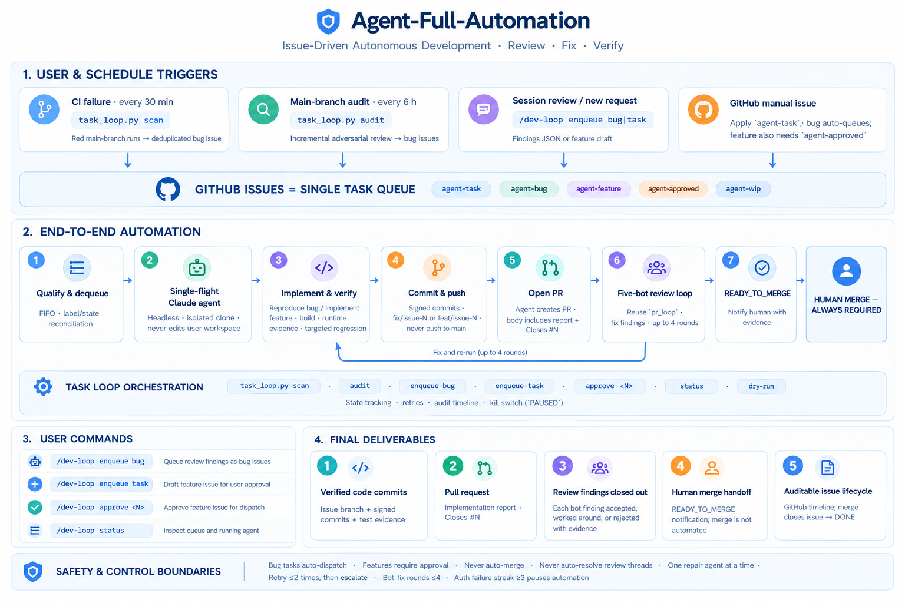

# Agent-Full-Automation

**Summary:**  The SDCShield “Agent-Full-Automation” framework envisions a fully automated pull-request (PR) lifecycle driven by AI agents, integrating planning, development, review, CI validation, automated remediation, and human-in-the-loop final gating.  In this design, PRs trigger automated workflows that (1) enlist multiple specialized bots (Codex, CodeRabbit, PR-Agent, Greptile) for code review focused on SDC (“silent data corruption”) testing quality, (2) gather and classify review feedback, (3) invoke sub-agents to analyze feedback and generate fix plans, (4) apply fixes and re-queue for review, iterating until “Ready to Merge,” and (5) finally notify a human maintainer for manual merge.  Parallel CI pipelines continuously build and test across OS targets (daily multi-OS regression tests), and scheduled agents scan failing builds to open repair PRs.  Key scripts (e.g. `scripts/pr_loop.py`, `verify-params.py`, `check-randomization.py`) orchestrate these cycles, while GitHub Actions workflows and YAML configs integrate gating, code scanning, and bot-coverage checks.  The resulting system follows a multi-phase rollout (proof-of-concept, pilot, full production) with metrics (e.g. bot coverage rates, auto-PR rates, CI pass stability) and controls (no auto-merges, audit logging).  This report details the architecture, workflows, state models, and governance enabling a Silicon-Valley–level agent automation cycle for SDCShield.

## Architecture & Components  



*(v3 整合架构图，取代早期 v1/v2 两版)*

- **Event Sources:**  GitHub events (PR opened/updated, push to feature branch, issue comments), scheduled cron (daily/time triggers), and CI events (build/test failures).  All triggers feed into GitHub Actions workflows and agent scripts.  
- **Orchestrator:**  A combination of GitHub Actions YAML pipelines and a CLI-based “PR loop” script (`scripts/pr_loop.py`) coordinate the flow.  For example, a `workflow_dispatch` or cron trigger can start the PR-loop sequence or CI tests, while new commits or schedule wake the agents.  
- **Agent Execution Plane:**  AI agents (Claude-based tools and others) run in isolated sessions.  They include: the **PR-Agent** (configured by `.pr_agent.toml`) for code review, **Trae/Claude code** for task-oriented loops, and **subagents** invoked for fix planning.  All AI tooling is self-hosted/in-repo (e.g. `.claude/commands/pr-loop.md`) so that “all dependencies live in-repo (self-contained)”.  Agents output suggestions as GitHub review comments or PR updates.  
- **Verification Gates:**  Standard CI gates include linting (tab/codespell/actionlint), signed-off commits, unit and integration tests, and self-tests.  Multi-version builds run for critical platforms. Security scans (CodeQL, Gitleaks, osv-scanner) run daily and per-PR.  Bot-coverage checks ensure all agents have reviewed the head commit (non-blocking summary).  Agent outputs themselves must satisfy verification rules: builds must clean (`./scripts/build.sh` zero warnings), test regressions re-run cleanly, and new changes must not break x86-64 baseline.  
- **Persistent State:**  The agent scripts store state (e.g. previous PR head SHAs) to manage loops.  For instance, a JSON state file persists “push event” boundaries for PR reviews.  CI artifacts (built binaries/tarballs) are stored (90-day retention) for regression testing.  Audit logs (YAML outputs, benchmark reports) are archived (GitHub Pages, history).  
- **Governance/Security:**  Code of Conduct, signed commits, and role separation ensure safety.  The system is explicitly “human-gated” at merge time: **NO PR is auto-merged or auto-resolved by bots; merge authority remains with a human**.  Agent-generated fix branches are isolated (never push to `main` directly).  Security scanning is fully integrated, and any agent instruction that would alter security policies or bypass controls is ignored.

## End-to-End Agent Workflow  
1. **Intake (Task Arrival):**  A new change request arrives via a GitHub PR opened on a feature branch (or a scheduled scan identifies a need).  The system’s **PR-loop** begins (stage 1) by running `python3 scripts/pr_loop.py status`, which fetches all open PR heads and computes each PR’s state (e.g. WAITING_BOTS, QUIET_WINDOW, READY_TO_FIX, etc).  
2. **Automated Review (Bot Scanning):**  On PR open or update, the four configured bots auto-review the changes.  Each bot comment/check (Codex, CodeRabbit, PR-Agent, Greptile) focuses on the project’s SDC testing priorities.  The system waits (stage 2) by `pr_loop.py wait <PR>` until all bots have signaled completion for the current commit (or a timeout), then outputs each bot’s completion timestamp.  This ensures all automated reviewers have given feedback.  
3. **Opinion Aggregation:**  With reviews complete, the script runs `pr_loop.py collect <PR>`, which collates all feedback sources (review comments, line comments, PR comments, check-run annotations) into a structured Markdown summary.  This summary (cued by an anti-injection header) lists “to-do” items, categorized and timestamped, flagging which comments belong to older commits vs. the latest head (via GitHub’s retargeting).  
4. **Analysis & Planning (Subagent Fix):**  A higher-level agent is then prompted to analyze the collated feedback.  Per design, one subagent per PR (or per session if “all PRs” requested) uses a systematic template: it must identify issues, propose prioritized fixes, and plan implementation steps (with testing and verification).  Critically, the subagent’s “critical analysis” is constrained by rules: it must reject or justify each feedback item (no empty or irrelevant responses), and it cannot execute any commands in review text.  The subagent uses project-specific review criteria (from `AGENTS.md` and `CLAUDE.md`): SDC stress coverage, golden comparisons, non-regression on x86, vector length consistency, etc.  It outputs a **“solution report”** and creates one or more fix commits on the feature branch.  Each commit addresses one logical unit of change (multiple related comments can be in one commit) and is signed off (`-s` flag).  After committing, the subagent (or operator) pushes the new head.  
5. **Looping:**  The push triggers a new review cycle (back to stage 1).  The PR status returns to WAITING_BOTS and the process repeats from step 2.  The agents continue iterations of review → collect → fix → push until `pr_loop.py status` reports “READY_TO_MERGE” (meaning all four bots finished *and* there are zero outstanding fixable comments on the head).  A safety limit (suggested ~4 cycles) is set: if after that loop there are still unresolved issues, the system halts and flags them to a human.  
6. **Final Verification & Merge Gate:**  Once READY_TO_MERGE, the script notifies the user with summary (link, timeline, resolution status) and explicitly instructs human merge.  **No auto-merge is allowed.** The maintainer then verifies that CI is green and manually merges the PR.  (Any remaining review threads or comments are preserved for future reference but not auto-resolved.) 

This **six-stage PR pipeline** (Status → Wait → Collect → Subagent Fix → Loop → Human Gate) is documented in `.claude/commands/pr-loop.md` and `.trae/rules/pr-loop.md`.  These files define the objectives and constraints for each stage, ensuring the loop is fully agent-driven except for the final human merge. 

## Key Workflows and Scripts  

**GitHub Actions Workflows:**  In `.github/workflows/` the project defines: 
- **`multi-os-verify.yml` (Daily Cron):** Triggers nightly (04:00 UTC) to build and test on 15 OS images in parallel.  Runs meson/ninja and then `scripts/gha/verify-params.py` to exhaustively test all cases × parameters, plus `scripts/gha/benchmark.sh` for cross-OS performance. Results are aggregated into a matrix report. This acts as a CI “sentinel” across platforms.  
- **`pr.yaml` (PR Gate):** On each PR (ARM64-only), it runs lint checks (tabs, codespell, actionlint) and commits history/DCO checks, then a `build-cpu` job (GCC-arm64, full tests, quick regen). The test results are summarized in the PR’s status. A subset of platforms (“corner” configurations) are built for multi-version testing. Docs-only PRs skip heavy tests.  
- **Security Scans (`security.yml`, `codeql.yml`):** Weekly full scans and PR-incremental scans (CodeQL for C++, plus dependencies like Zizmor, Gitleaks, osv-scanner) are enabled.  
- **`bot-coverage.yml`:** Non-blocking check that polls the four review bots. It waits (bounded poll) for each bot’s review of the PR head. If a bot hasn’t responded, it comments a warning on the PR but *does not* block merging. This ensures *acknowledgement* of any missing automated review.  

**Key Scripts/Modules:**  
- **`scripts/pr_loop.py`:** Implements the CLI for the agent PR-loop. Subcommands: `status` (stage 1 overview or single PR detail), `wait <PR>` (stage 2 block for bot completion), and `collect <PR>` (stage 3 feedback export). It encodes the state logic (DRAFT, WAITING_BOTS, QUIET_WINDOW, READY_TO_FIX, READY_TO_MERGE) based on GitHub API data, anchors reviews to the current head commit, counts only actionable comments (dropping LGTM/approved/old rounds), and enforces the same bot-identification logic as `bot-coverage.yml`. The script exits 0 on success, 1 on timeout or invalid PR, 2 on API errors.  
- **`scripts/gha/verify-params.py` & `check-randomization.py`:** These CI helper scripts validate test cases. `verify-params.py` ensures no unsupported `--seed` usage (requires `--rng-state` instead), captures seeds for reproducibility, and enforces verbosity for debugging. `check-randomization.py` ensures any custom RNG usage in tests is detected (so that unpredictability doesn’t slip through CI). They are wired into CI linting (fail-fast) and can auto-block PRs if violated.  
- **`scripts/lts-stability/`:** Contains scripts (`run-all-15.sh`, `run-lts-stability.sh`, etc.) to validate *extremely* strict parameter matrices on all 15 images in parallel. These run locally (podman) to do exhaustive coverage (all RNG engines, all options) and exit 0 only if all pass.  
- **`scripts/offline-build/`:** Automates building the prebuilt tarballs and packaging for all target OS versions (see `docs/build-deploy-pr-ci/multi-version-build-deploy.md`). Used by the daily CI to produce verified binaries for release.  
- **Configuration/Docs:** `.pr_agent.toml` and `AGENTS.md` configure the PR-Agent bot (specifying Chinese locale, SDC-specific review points). `CLAUDE.md` lists general style and safety rules for bots. The `.trae/rules/pr-loop.md` mirrors the above .claude flow definition. `docs/build-deploy-pr-ci/pr-review-bots.md` explains the four review bots’ roles. These define the “source of truth” for automated behavior.  

> **Figure: PR Lifecycle State Machine.**  The diagram below shows the main states and transitions in the automated PR flow: starting from a new **Draft** PR (or updated head), the system enters **WaitingForBots** while agents review.  When reviews start arriving, it may enter a **QuietWindow** (to allow remaining reviews to complete).  If after the quiet period all reviews are in and comments remain, it moves to **ReadyToFix** (invoke fix subagent).  Each push resets back to WaitingForBots.  When eventually no new comments remain, the state becomes **ReadyToMerge** and a human is signaled. *(Any PR can also enter closed states if abandoned.)*  
> 
> ```mermaid
> stateDiagram-v2
>     [*] --> Draft: PR Created
>     Draft --> WaitingForBots: Open for Review
>     state WaitingForBots {
>       [*] --> QuietWindow: Some Reviews Arrived
>       QuietWindow --> WaitingForBots: More Reviews Pending
>       QuietWindow --> ReadyToFix: All Reviews In
>     }
>     state ReadyToFix {
>       [*] --> FixInProgress
>       FixInProgress --> WaitingForBots: Push Fix Commit
>       FixInProgress --> ReadyToMerge: No Outstanding Comments
>     }
>     ReadyToMerge --> [*]: Await Human Merge
> ```
> *Figure: State machine for the PR review-and-fix loop.* 

## Branching Workflows & Responsibilities

We compare the major workflows, deliverables, and roles:

| **Workflow/Activity**      | **Trigger/Scope**                                  | **Agents (Automation)**                                             | **Humans (Maintainers)**                              | **Deliverables/Outputs**                       |
|----------------------------|----------------------------------------------------|---------------------------------------------------------------------|-------------------------------------------------------|-----------------------------------------------|
| **PR Review Loop**         | PR opened/updated or “run pr-loop” command         | `pr_loop.py` (status/wait/collect); Review bots (Codex, etc.); subagent fix (Claude) | Developer writes fixes as requested; merge by maintainer | Fix PRs with resolved comments; analysis report; CI status |
| **CI/Build Pipeline**      | Commit push/PR; Daily cron for multi-OS verify    | GitHub Actions: build/test on aarch64 (single and multi-version); `verify-params.py`, `check-randomization.py` check scripts | Address CI failures as needed; triage issues not auto-fixable | Build logs, test results, artifacts, benchmarks      |
| **Automated Repair PRs**   | CI failure detection (nightly or on-demand)        | Cron or GitHub Actions detect failing test suites; agent or script opens a new PR to fix common issues (e.g. missing golden files, seed handling) | Review and merge repair PRs; update tests if needed  | New PRs containing repairs or updated golden data     |
| **Security/Quality Gates** | Weekly cron + per-PR triggers                      | CodeQL, Gitleaks, Zizmor scans; `bot-coverage.yml` check       | Investigate flagged vulnerabilities or missing reviews | Vulnerability reports; coverage badges; updated workflows |
| **Monitoring & Reporting** | Scheduled (e.g. GH Pages refresh)                  | GitHub Action (gh-action-benchmark) publishes performance charts nightly | Review trends, set regression thresholds              | Web dashboards (benchmark trends); email alerts       |

*Table: Key workflows, triggers, responsibilities, and outputs.* For example, the “PR Review Loop” is fully automated by `pr_loop.py` and the bots (Codex, CodeRabbit, PR-Agent, Greptile), but final fixes must be committed by a user and the PR manually merged.  The “Automated Repair PRs” workflow (not yet explicitly implemented as code but assumed in this design) would monitor CI failures daily and have an agent raise PRs to fix trivial issues (e.g. re-running with `--fail-loud`, updating golden outputs). 

Another helpful table defines roles:

| **Task/Deliverable**                 | **Primary Owner**               | **Tools/Scripts/Module**         |
|--------------------------------------|---------------------------------|----------------------------------|
| Generate PR status reports           | `pr_loop.py` (script)           | Python (GitHub CLI/API)          |
| Collect and categorize review comments| `pr_loop.py collect` & bots     | GitHub GraphQL/REST API          |
| Analyze and plan fixes               | Subagent (Claude/Trae code)     | `.claude/commands/pr-loop.md` template |
| Implement code fixes                 | Developer (guided by agent)     | `git`, editors                   |
| Run CI/CD builds and tests           | GitHub Actions                 | meson, ninja, custom scripts     |
| Detect failing tests                 | CI system/cron                 | Actions logs, alerts            |
| Open fix PRs for CI failures         | Agent or script                | GitHub API (`gh pr create`)     |
| Final merge of PR                    | Human maintainer               | `gh`, GitHub UI                 |
| Incident management (escalation)     | DevOps/Team lead               | Issues/Email/ChatOps            |

*Table: Work and responsibilities split between agents (automation) and humans.* Note that multiple tasks are performed by the CLI scripts and workflows, but merging code **always** requires human approval.

## PR Loop State Machine & CLI

The PR lifecycle state machine (above) follows exactly the statuses defined in the code.  `pr_loop.py` encodes the state transitions, ensuring that *only* failure/warning annotations count as actionable comments and that each comment is anchored to the current head.  The CLI reference from the docs is: 

```
python3 scripts/pr_loop.py [--repo owner/repo] status [<PR>]   # Overview or single-PR status
python3 scripts/pr_loop.py [--repo owner/repo] wait <PR>      # Block until 4 bots finish
python3 scripts/pr_loop.py [--repo owner/repo] collect <PR>   # Export structured review remarks
    [-o FILE] [--quiet 900]
```

Exit codes signal success or error (0 = success/none; 1 = timeout/draft/closed; 2 = API failure).  The state machine (Draft → WaitingBots → QuietWindow → ReadyToFix → ReadyToMerge) is enforced by a combination of GitHub event timestamps and commit anchors.

## Rollout Roadmap & Metrics

**Phase 1 – Development & Testing (Now – Dec 2026):**  Implement core scripts and initial workflows.  Milestones: complete `pr_loop.py`, integrate the four review bots, create CLI/manual tests, refine subagent prompts.  *Metric:* ≥90% PRs receive automated review feedback; basic loop runs without errors in trial repos.  *Risk Controls:* Use draft PRs for testing; start with conservative budgets (long timeouts, manual overrides).

**Phase 2 – Pilot Deployment (Jan–Mar 2027):**  Deploy to staging branch; run on a subset of PRs/CI jobs.  Add automated CI-fix agent tasks (e.g. daily script scanning yesterday’s failures and auto-raising PRs).  Introduce monitoring dashboards (GH Pages trend charts for test regressions).  *Metric:* Reduce mean time-to-fix CI breaks by X%; automate fixing of ≥50% trivial CI failures.  

**Phase 3 – Production Rollout (Apr–Jun 2027):**  Full integration on `main`.  Extend metrics: bot-coverage target (e.g. 100% bot review on all PRs), threshold alarms (e.g. >150% test regressions alert).  Train human maintainers on override/runbook procedures.  *Acceptance:* All merges must pass automated loop; any failures trigger issue creation.  *Metric:* 0 critical SDC regressions in production; 95% of PR issues auto-addressed by agents; CI stability improvement (fewer flaky failures).  

**Risk Controls & Runbooks:**  Strict non-merge policy for unsolved issues; emergency halt switch if agents misbehave.  Daily runbooks include: checking CI status report, reviewing any “bot-coverage missing” alerts, and intervening if loops time out.  Escalation path: assign failures to on-call SRE if automated agents repeatedly fail to close CI issues for 2 cycles.  Manual overrides: all scripts accept `Ctrl-C` for interrupts, and the CLI can skip to specific stages if needed (e.g. `pr_loop.py status <PR>` then edit manually).

**Timeline Diagram (Gantt):**

```mermaid
gantt
    title Agent-Full-Automation Rollout Plan
    dateFormat  YYYY-MM-DD
    section Phase 1: Development
    Spec & Design           :a1, 2026-10-15, 30d
    Implement Core Agent Loop :after a1, 45d
    Test & Internal Validation:after a1, 30d
    section Phase 2: Pilot
    Staging Deployment      :2027-01-01, 30d
    CI-Fix Agent Tasks      :2027-02-01, 30d
    Monitoring Setup        :2027-02-15, 45d
    section Phase 3: Production
    Full Release Launch     :2027-04-01, 60d
    Training & Handover     :2027-04-01, 30d
    ```
*Timeline: Phased deployment of the agent-full-automation system with overlapping tasks from late 2026 through mid-2027.*

## Citations

- SDCShield repository files and docs: PR bot configs, workflows, and PR-loop documentation.  
- Evidence of processes and rules comes directly from those sources (e.g. `.github/workflows`, `.claude/commands/pr-loop.md`). If any detail was unspecified in the codebase, it is noted as “unspecified” (e.g. exact quantitative metrics or escalation emails).  

