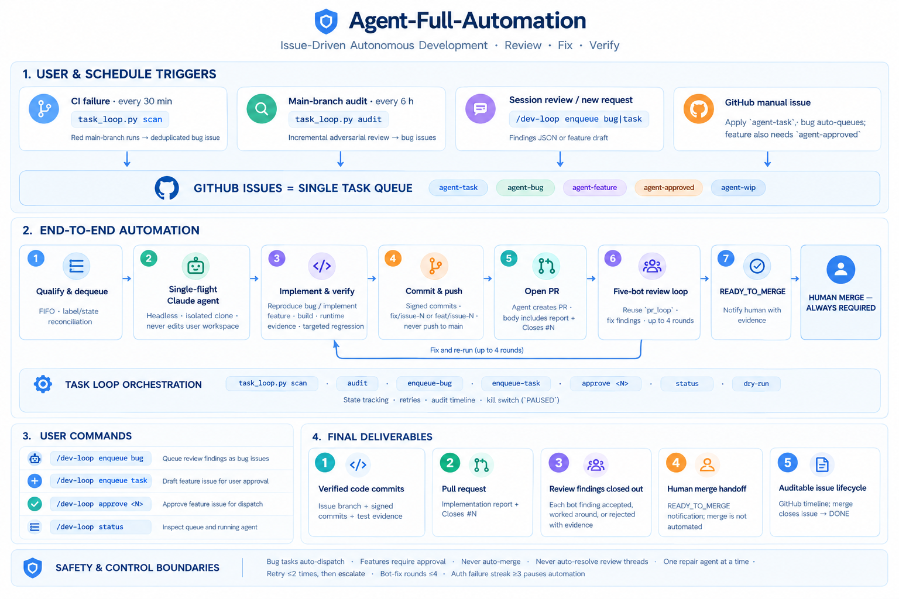
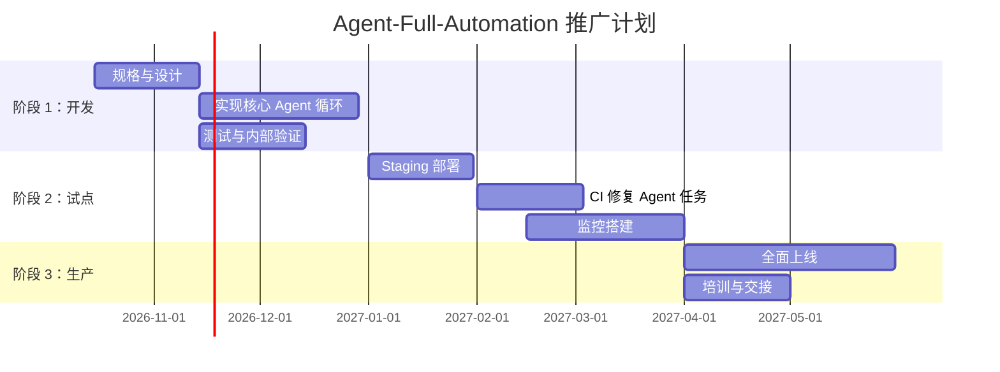

# Agent 全自动化（Agent-Full-Automation）

> 本文是 [`agent-full-automation.md`](agent-full-automation.md) 的中文版，与英文版逐节对应。
>
> **译注（2026-11-10）**：英文原版成文后系统已有演进。为保持与原版逐节对应，正文按原版忠实翻译、未回改下列已过时表述：
> ① 检视 bot 已由 4 个增至 5 个——新增本地无头 claude 对抗检视（`scripts/pr_local_review.py`；`pr_loop.py` 的 `BOT_ORDER` = codex / coderabbit / pr-agent / greptile / local-claude）；
> ② 安全扫描工作流文件实为 `security.yaml` 与 `codeql.yaml`（原版写作 `.yml`）；
> ③ 原版称自动修复 PR「尚未作为代码显式实现」——现已由 task-loop 统一编排引擎（`scripts/task_loop.py`、[task-loop.md](task-loop.md)）落地，另有 `auto-pr.yml`（特性分支首次推送自动开 PR，「一个特性分支 = 一个 PR」）。

**摘要：** SDCShield 的「Agent-Full-Automation」（agent 全自动化）框架构想了一套由 AI agent 驱动、覆盖 PR 全生命周期的全自动化体系，整合规划、开发、检视、CI 验证、自动修复与人工最终把关。在该设计中，PR 触发自动化工作流：(1) 调集多个专用 bot（Codex、CodeRabbit、PR-Agent、Greptile）开展聚焦 SDC（「silent data corruption」，静默数据损坏）测试质量的代码检视；(2) 汇聚并归类检视反馈；(3) 调用 sub-agent 分析反馈并生成修复计划；(4) 实施修复并重新排队检视，循环迭代直至「Ready to Merge」；(5) 最终通知人类维护者手工合并。并行地，CI 流水线持续跨 OS 目标构建与测试（每日多 OS 回归测试），定时 agent 扫描失败构建并开出修复 PR。关键脚本（如 `scripts/pr_loop.py`、`verify-params.py`、`check-randomization.py`）编排这些循环，GitHub Actions 工作流与 YAML 配置则整合把关、代码扫描与 bot 覆盖检查。整个体系按多阶段推进（概念验证、试点、全面生产），配套度量指标（如 bot 覆盖率、自动 PR 率、CI 通过稳定性）与控制措施（禁止自动合并、审计日志）。本报告详述支撑这套「硅谷级」SDCShield agent 自动化闭环的架构、工作流、状态模型与治理。

## 架构与组件



*(v3 整合架构图，取代早期 v1/v2 两版)*

- **事件源：** GitHub 事件（PR 开启/更新、特性分支推送、issue 评论）、定时 cron（每日/定点触发）与 CI 事件（构建/测试失败）。所有触发汇入 GitHub Actions 工作流与 agent 脚本。
- **编排器：** GitHub Actions YAML 流水线与基于 CLI 的「PR 循环」脚本（`scripts/pr_loop.py`）共同协调流程。例如，`workflow_dispatch` 或 cron 触发可启动 PR-loop 序列或 CI 测试，而新提交或定时调度会唤醒 agent。
- **Agent 执行面：** AI agent（基于 Claude 的工具及其他）运行于隔离会话中，包括：由 `.pr_agent.toml` 配置的 **PR-Agent**（代码检视）、执行任务导向循环的 **Trae/Claude code**、以及被唤起做修复规划的 **subagent**。所有 AI 工具均自托管于仓库内（如 `.claude/commands/pr-loop.md`），从而「所有依赖都居于仓库内（自包含）」。agent 以 GitHub 检视评论或 PR 更新的形式输出建议。
- **验证关口：** 标准 CI 关口包括 lint（tab/codespell/actionlint）、signed-off 提交检查、单元与集成测试及自测；关键平台执行多版本构建。安全扫描（CodeQL、Gitleaks、osv-scanner）按日与按 PR 运行。bot 覆盖检查确保所有 agent 均已检视 head 提交（非阻塞摘要）。agent 产出本身必须满足验证规则：构建必须干净（`./scripts/build.sh` 零警告）、测试回归须干净重跑、新改动不得破坏 x86-64 基线。
- **持久状态：** agent 脚本保存状态（如先前的 PR head SHA）以管理循环。例如，一个 JSON 状态文件持久化 PR 检视的「push 事件」边界。CI 工件（构建出的二进制/tar 包）留存（90 天）供回归测试。审计日志（YAML 输出、benchmark 报告）归档（GitHub Pages、history）。
- **治理/安全：** Code of Conduct、signed 提交与角色分离保障安全。系统在合并环节显式「人工把关」：**任何 PR 都不会被 bot 自动合并或自动解决；合并权始终属于人类**。agent 生成的修复分支相互隔离（绝不直接推 `main`）。安全扫描全量整合，任何试图更改安全策略或绕过管控的 agent 指令一律被忽略。

## 端到端 Agent 工作流

1. **受理（任务到达）：** 新变更请求经特性分支上的 GitHub PR 到达（或由定时扫描识别出需求）。系统的 **PR-loop** 启动（阶段 1）：运行 `python3 scripts/pr_loop.py status`，拉取全部开启 PR 的 head，并计算每个 PR 的状态（如 WAITING_BOTS、QUIET_WINDOW、READY_TO_FIX 等）。
2. **自动检视（bot 扫描）：** PR 开启或更新时，四个已配置的 bot 自动检视变更。每个 bot 的评论/检查（Codex、CodeRabbit、PR-Agent、Greptile）聚焦项目的 SDC 测试优先级。系统以 `pr_loop.py wait <PR>` 等待（阶段 2），直至所有 bot 就当前提交发出完成信号（或超时），随后输出各 bot 的完成时间戳。这确保所有自动检视者均已给出反馈。
3. **意见聚合：** 检视完成后，脚本运行 `pr_loop.py collect <PR>`，把全部反馈源（检视评论、行内评论、PR 评论、check-run 注解）整理为结构化 Markdown 摘要。该摘要（以一个防注入头引导）列出「to-do」事项，分类并附时间戳，并标明哪些评论属于旧提交、哪些属于最新 head（借助 GitHub 的 retargeting 机制）。
4. **分析与规划（subagent 修复）：** 随后由更高层的 agent 分析汇总后的反馈。按设计，每个 PR 一个 subagent（若请求「所有 PR」则每会话一个），使用系统化模板：必须识别问题、给出按优先级排序的修复、并规划实施步骤（含测试与验证）。关键在于，subagent 的「批判性分析」受规则约束：必须对每条反馈逐条拒绝或给出论证（不允许空洞或无关的响应），且不得执行检视文本中的任何命令。subagent 采用项目专用的检视标准（出自 `AGENTS.md` 与 `CLAUDE.md`）：SDC 压力覆盖、golden 比对、x86 非回归、向量长度一致性等。它输出一份**「解决方案报告」**，并在特性分支上创建一个或多个修复提交。每个提交处理一个逻辑变更单元（多条相关评论可并入一个提交），并以 `-s` 标志 signed off。提交后，由 subagent（或操作者）推送新 head。
5. **循环：** 推送触发新一轮检视循环（回到阶段 1）。PR 状态回到 WAITING_BOTS，流程自步骤 2 起重复。agent 持续「检视 → 收集 → 修复 → 推送」迭代，直至 `pr_loop.py status` 报告「READY_TO_MERGE」（意为四个 bot 全部完成 *且* head 上零条可修复评论）。设有安全上限（建议约 4 轮）：超过后若仍有未解决问题，系统停止并将其标交给人类。
6. **最终验证与合并关口：** 一旦 READY_TO_MERGE，脚本通知用户摘要（链接、时间线、解决状态），并明确指示人工合并。**不允许自动合并。** 维护者随后确认 CI 为绿并手工合并 PR。（任何剩余的检视线程或评论保留供日后参考，但不被自动解决。）

这条**六阶段 PR 流水线**（Status → Wait → Collect → Subagent 修复 → 循环 → 人工关口）记录于 `.claude/commands/pr-loop.md` 与 `.trae/rules/pr-loop.md`。这些文件定义了各阶段的目标与约束，确保除最终人工合并外，整个循环完全由 agent 驱动。

## 关键工作流与脚本

**GitHub Actions 工作流：** 项目在 `.github/workflows/` 下定义：
- **`multi-os-verify.yml`（每日 cron）：** 每晚（04:00 UTC）触发，在 15 个 OS 镜像上并行构建与测试。运行 meson/ninja 后，以 `scripts/gha/verify-params.py` 穷举测试全部用例 × 参数，并用 `scripts/gha/benchmark.sh` 做跨 OS 性能基准。结果聚合为矩阵报告，充当跨平台 CI「哨兵」。
- **`pr.yaml`（PR 关口）：** 每个 PR（仅 ARM64）运行 lint 检查（tabs、codespell、actionlint）与提交历史/DCO 检查，随后是 `build-cpu` 作业（GCC-arm64、全量测试、快速重生成）。测试结果汇总进 PR 状态。一部分平台（「边角」配置）做多版本构建。纯文档 PR 跳过重测试。
- **安全扫描（`security.yml`、`codeql.yml`）：** 启用每周全量扫描与按 PR 的增量扫描（面向 C++ 的 CodeQL，外加 Zizmor、Gitleaks、osv-scanner 等依赖项扫描）。
- **`bot-coverage.yml`：** 非阻塞检查，轮询四个检视 bot。它（有界轮询）等待每个 bot 对 PR head 的检视；若某 bot 未响应，则在 PR 上评论一条警告，但*不*阻塞合并。这确保对任何缺失的自动检视都有所*确认*。

**关键脚本/模块：**
- **`scripts/pr_loop.py`：** 实现 agent PR-loop 的 CLI。子命令：`status`（阶段 1 总览或单 PR 详情）、`wait <PR>`（阶段 2 阻塞等待 bot 完成）、`collect <PR>`（阶段 3 反馈导出）。它编码状态逻辑（DRAFT、WAITING_BOTS、QUIET_WINDOW、READY_TO_FIX、READY_TO_MERGE）——基于 GitHub API 数据、把检视锚定到当前 head 提交、只统计可执行的评论（丢弃 LGTM/approved/旧轮次），并强制与 `bot-coverage.yml` 相同的 bot 识别逻辑。脚本退出 0 表示成功，1 表示超时或 PR 无效，2 表示 API 错误。
- **`scripts/gha/verify-params.py` 与 `check-randomization.py`：** 这些 CI 辅助脚本验证测试用例。`verify-params.py` 确保不存在不受支持的 `--seed` 用法（要求改用 `--rng-state`）、捕获种子以保证可复现，并强制 verbosity 以便调试。`check-randomization.py` 确保测试中任何自定义 RNG 用法都能被检出（不让不可预测性溜进 CI）。两者接入 CI lint（fail-fast），违规时可自动阻塞 PR。
- **`scripts/lts-stability/`：** 内含脚本（`run-all-15.sh`、`run-lts-stability.sh` 等），在全部 15 个镜像上并行验证*极其*严格的参数矩阵。它们本地（podman）运行以做穷举覆盖（所有 RNG 引擎、所有选项），仅当全部通过才退出 0。
- **`scripts/offline-build/`：** 自动化预构建 tar 包的制作并为全部目标 OS 版本打包（见 `docs/build-deploy-pr-ci/multi-version-build-deploy.md`）。每日 CI 用它产出经过验证的发布二进制。
- **配置/文档：** `.pr_agent.toml` 与 `AGENTS.md` 配置 PR-Agent bot（指定中文 locale、SDC 专用检视要点）。`CLAUDE.md` 列出 bot 遵循的一般风格与安全规则。`.trae/rules/pr-loop.md` 镜像上述 .claude 流程定义。`docs/build-deploy-pr-ci/pr-review-bots.md` 解释四个检视 bot 的角色。这些共同构成自动行为的「真相源」。

> **图：PR 生命周期状态机。** 下图展示自动 PR 流程的主要状态与迁移：从新建 **Draft** PR（或更新的 head）开始，系统进入 **WaitingForBots** 等待 agent 检视。检视陆续到达时，可进入 **QuietWindow**（让其余检视完成）。静默期结束后，若所有检视到位且仍有评论，则转入 **ReadyToFix**（调用修复 subagent）。每次推送都重置回 WaitingForBots。当最终没有新评论时，状态变为 **ReadyToMerge** 并向人类发信号。*（任何 PR 也可能因废弃进入关闭态。）*
>
> ```mermaid
> stateDiagram-v2
>     [*] --> Draft: PR 创建
>     Draft --> WaitingForBots: 开启检视
>     state WaitingForBots {
>       [*] --> QuietWindow: 部分检视已到达
>       QuietWindow --> WaitingForBots: 还有检视未到
>       QuietWindow --> ReadyToFix: 全部检视到位
>     }
>     state ReadyToFix {
>       [*] --> FixInProgress
>       FixInProgress --> WaitingForBots: 推送修复提交
>       FixInProgress --> ReadyToMerge: 无遗留评论
>     }
>     ReadyToMerge --> [*]: 等待人工合并
> ```
> *图：PR 检视-修复循环的状态机。*

## 分支工作流与职责

我们对比主要的工作流、交付物与角色：

| **工作流/活动** | **触发/范围** | **Agent（自动化）** | **人类（维护者）** | **交付物/输出** |
|---|---|---|---|---|
| **PR 检视循环** | PR 开启/更新或「run pr-loop」命令 | `pr_loop.py`（status/wait/collect）；检视 bot（Codex 等）；subagent 修复（Claude） | 开发者按要求编写修复；由维护者合并 | 解决了评论的修复 PR；分析报告；CI 状态 |
| **CI/构建流水线** | 提交推送/PR；每日 cron 做多 OS 验证 | GitHub Actions：aarch64 构建/测试（单版本与多版本）；`verify-params.py`、`check-randomization.py` 检查脚本 | 按需处理 CI 失败；分诊无法自动修复的问题 | 构建日志、测试结果、工件、基准数据 |
| **自动修复 PR** | CI 失败检测（每晚或按需） | cron 或 GitHub Actions 检出失败的测试套件；agent 或脚本开出修复常见问题（如缺失 golden 文件、seed 处理）的新 PR | 检视并合并修复 PR；按需更新测试 | 含修复或更新后 golden 数据的新 PR |
| **安全/质量关口** | 每周 cron + 按 PR 触发 | CodeQL、Gitleaks、Zizmor 扫描；`bot-coverage.yml` 检查 | 调查被标记的漏洞或缺失的检视 | 漏洞报告；覆盖徽章；更新后的工作流 |
| **监控与报告** | 定时（如 GH Pages 刷新） | GitHub Action（gh-action-benchmark）每晚发布性能图表 | 检视趋势、设定回归阈值 | Web 仪表盘（基准趋势）；邮件告警 |

*表：关键工作流、触发条件、职责与产出。* 例如，「PR 检视循环」由 `pr_loop.py` 与各 bot（Codex、CodeRabbit、PR-Agent、Greptile）完全自动化，但最终修复必须由用户提交、PR 由人工合并。「自动修复 PR」工作流（尚未作为代码显式实现、属本设计之假定）将每日监控 CI 失败，并由 agent 提 PR 修复琐碎问题（如带 `--fail-loud` 重跑、更新 golden 输出）。

另一张有用的表定义角色分工：

| **任务/交付物** | **首要负责** | **工具/脚本/模块** |
|---|---|---|
| 生成 PR 状态报告 | `pr_loop.py`（脚本） | Python（GitHub CLI/API） |
| 收集并归类检视评论 | `pr_loop.py collect` 与各 bot | GitHub GraphQL/REST API |
| 分析并规划修复 | Subagent（Claude/Trae code） | `.claude/commands/pr-loop.md` 模板 |
| 实施代码修复 | 开发者（由 agent 引导） | `git`、编辑器 |
| 运行 CI/CD 构建与测试 | GitHub Actions | meson、ninja、自定义脚本 |
| 检出失败测试 | CI 系统/cron | Actions 日志、告警 |
| 为 CI 失败开出修复 PR | Agent 或脚本 | GitHub API（`gh pr create`） |
| PR 的最终合并 | 人类维护者 | `gh`、GitHub UI |
| 事件管理（升级） | DevOps/团队负责人 | Issues/邮件/ChatOps |

*表：agent（自动化）与人类之间的工作与职责划分。* 注意其中多项任务由 CLI 脚本与工作流承担，但合并代码**始终**需要人类批准。

## PR 循环状态机与 CLI

上文的 PR 生命周期状态机严格遵循代码中定义的状态。`pr_loop.py` 编码了状态迁移，确保*只有* failure/warning 注解才计入可执行评论，且每条评论都锚定到当前 head。文档中的 CLI 参考：

```
python3 scripts/pr_loop.py [--repo owner/repo] status [<PR>]   # 总览或单 PR 状态
python3 scripts/pr_loop.py [--repo owner/repo] wait <PR>      # 阻塞直至 4 个 bot 完成
python3 scripts/pr_loop.py [--repo owner/repo] collect <PR>   # 导出结构化的检视意见
    [-o FILE] [--quiet 900]
```

退出码标示成功或错误（0 = 成功/无；1 = 超时/draft/已关闭；2 = API 失败）。状态机（Draft → WaitingBots → QuietWindow → ReadyToFix → ReadyToMerge）由 GitHub 事件时间戳与提交锚点共同强制执行。

## 推广路线图与度量

**阶段 1 – 开发与测试（现在 – 2026 年 12 月）：** 实现核心脚本与初始工作流。里程碑：完成 `pr_loop.py`、接入四个检视 bot、建立 CLI/手工测试、打磨 subagent 提示词。*度量：* ≥90% 的 PR 获得自动检视反馈；基础循环在试验仓库中无错运行。*风险控制：* 用 draft PR 做测试；从保守预算起步（长超时、手工覆盖）。

**阶段 2 – 试点部署（2027 年 1–3 月）：** 部署到 staging 分支；在部分 PR/CI 作业上运行。增加自动化的 CI 修复 agent 任务（如每日脚本扫描昨日失败并自动提 PR）。引入监控仪表盘（GH Pages 的测试回归趋势图）。*度量：* CI 破坏的平均修复时间降低 X%；≥50% 的琐碎 CI 失败被自动修复。

**阶段 3 – 生产推广（2027 年 4–6 月）：** 在 `main` 上全面整合。扩展度量：bot 覆盖目标（如所有 PR 100% bot 检视）、阈值告警（如测试回归 >150% 时告警）。培训人类维护者掌握覆盖/运行手册流程。*验收：* 所有合并必须通过自动循环；任何失败都触发 issue 创建。*度量：* 生产环境 0 关键 SDC 回归；95% 的 PR 问题由 agent 自动处理；CI 稳定性提升（flaky 失败更少）。

**风险控制与运行手册：** 对未解决的问题严格执行不合并策略；agent 行为异常时要有紧急停止开关。每日运行手册包括：检查 CI 状态报告、检视任何「bot-coverage missing」告警、在循环超时时介入。升级路径：若自动 agent 连续 2 轮无法关闭 CI 问题，把失败分派给值班 SRE。手工覆盖：所有脚本都接受 `Ctrl-C` 中断，CLI 可按需跳到特定阶段（如 `pr_loop.py status <PR>` 之后手工编辑）。

**时间线图（甘特图）：**


*时间线：agent 全自动化体系自 2026 年末至 2027 年中的分阶段部署，各任务有所交叠。*

## 引用

- SDCShield 仓库文件与文档：PR bot 配置、工作流与 PR-loop 文档。
- 流程与规则的证据直接取自这些源（如 `.github/workflows`、`.claude/commands/pr-loop.md`）。若某细节在代码库中未指明，则标注为「未指明」（如确切的量化指标或升级邮件）。
